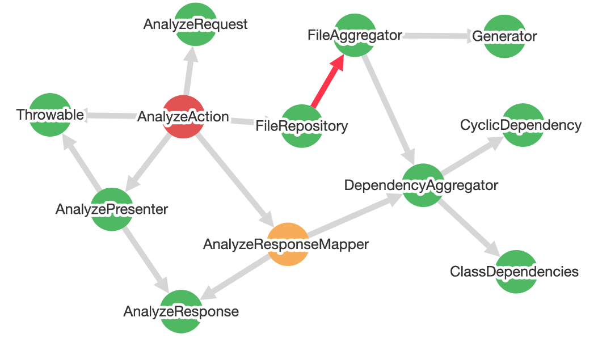

<p align="center">

</p>


# php-class-dependencies-analyzer

[](https://github.com/DeGraciaMathieu/php-class-dependencies-analyzer/actions/workflows/testing.yml)


## Phar
This tool is distributed as a [PHP Archive (PHAR)](https://www.php.net/phar):

```
wget https://github.com/DeGraciaMathieu/php-class-dependencies-analyzer/raw/main/builds/class-dependencies-analyzer
```

```
php class-dependencies-analyzer --version
```

The PHAR exposes the `analyze` command from version 1.0.0. Coming from 0.x (`weakness`, `cyclic`, `analyze:class`, `analyze:component`)? See [UPGRADE.md](UPGRADE.md).

## Usage

The `analyze` command builds the dependency graph of your classes once, then reports the Robert C. Martin metrics per class and per component, the dependency cycles and the violations of the Stable Dependencies Principle (SDP):

```
php class-dependencies-analyzer analyze app
```

Choose the sections with `--report` (`classes`, `components`, `cycles`, `sdp`; components, cycles and SDP by default) and keep or ignore classes with FQCN globs:

```
php class-dependencies-analyzer analyze app --report=classes,components --only='App\Domain\*' --exclude='App\Domain\Tests\*'
```

## Configuration: `dependencies.php`

A `dependencies.php` file at the root of the project declares the paths to analyze, the components and the rules checked on every run. `analyze` picks it up automatically:

```php
<?php

use App\Core\Config\Config;
use App\Core\Rules\Rules;

return Config::make()
    ->paths(['app'])
    ->components([
        'Domain' => 'App\Domain\*',
        'Application' => 'App\Application\*',
        'Infrastructure' => ['App\Infrastructure\*', 'App\Commands\*'],
    ])
    ->rules([
        Rules::noCycles(),
        Rules::stableDependencies(),
        Rules::maxDistanceFromMainSequence(0.7),
    ]);
```

```
php class-dependencies-analyzer analyze
```

The command exits with `1` when a rule is violated, which fails a CI job, and with `2` on an invalid configuration. A baseline freezes the existing violations so that only new ones fail the build.

## Output formats

| Format | Usage |
| --- | --- |
| `table` | Human-readable report (default) |
| `json` | Machine-readable report (`"schema": 1`) |
| `sarif` | SARIF 2.1.0 log for GitHub code scanning |
| `html` | Standalone interactive graph of components and classes, requires `--output` |

```
php class-dependencies-analyzer analyze --format=html --output=dependencies.html
php class-dependencies-analyzer analyze --format=sarif --output=dependencies.sarif
```

See [docs/ci.md](docs/ci.md) for every option, the exit codes, the baseline, the parse cache and ready-to-use GitHub Actions and GitLab CI jobs.

## Documentation

Full documentation [here](https://php-quality-tools.com/class-dependencies-analyzer/).

<p align="center">

</p>

> 🇫🇷 For French developers, an [article](https://laravel-france.com/posts/des-dependances-stables-pour-une-architecture-de-qualite) on Laravel France explores these stable dependency concepts.

> [!TIP]  
> Other analysis [tools](https://github.com/DeGraciaMathieu) are available.
