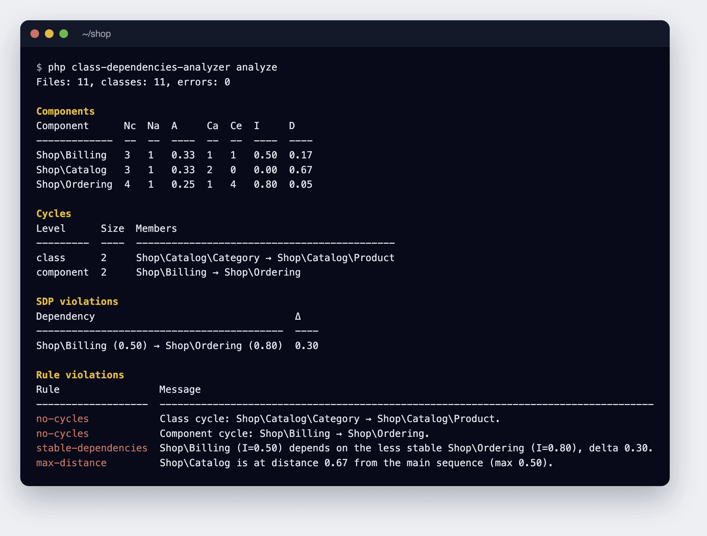
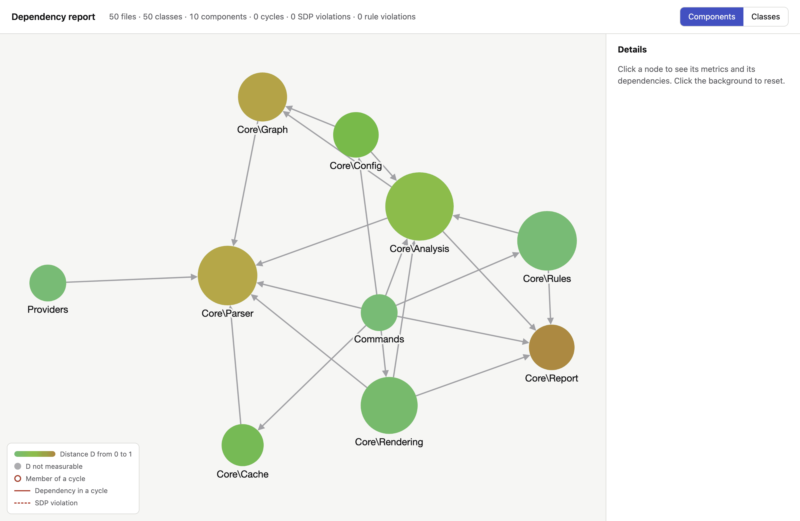
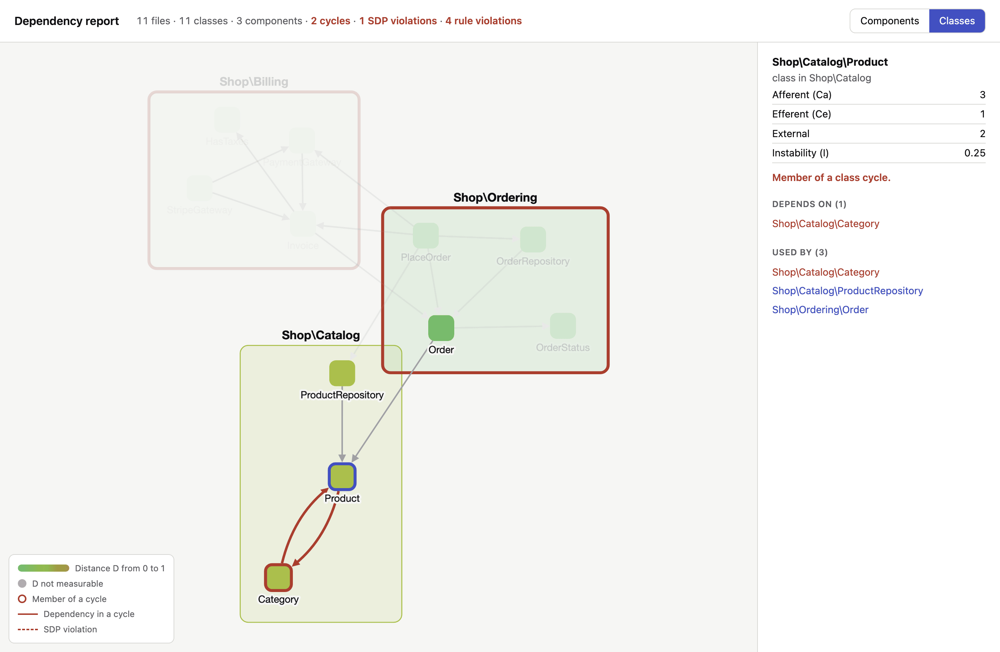

<p align="center">

</p>

# php-class-dependencies-analyzer

[](https://github.com/DeGraciaMathieu/php-class-dependencies-analyzer/actions/workflows/testing.yml)


Measure how your PHP classes and components depend on each other, find dependency cycles and the dependencies that break the Stable Dependencies Principle, then fail your CI when the architecture drifts.

The analyzer builds the dependency graph of your code once and reports:

- the **coupling of each class**: afferent (Ca) and efferent (Ce) coupling, instability (I);
- the **Robert C. Martin metrics of each component**: abstractness (A), instability (I) and distance from the main sequence (D);
- the **dependency cycles**, between classes and between components;
- the **Stable Dependencies Principle (SDP) violations**: a component depending on a less stable one.

## Installation

The tool is distributed as a [PHP Archive (PHAR)](https://www.php.net/phar) and requires PHP 8.2 or later:

```
wget https://github.com/DeGraciaMathieu/php-class-dependencies-analyzer/raw/main/builds/class-dependencies-analyzer
```

```
php class-dependencies-analyzer --version
```

## Quick start

```
php class-dependencies-analyzer analyze app
```

<p align="center">

</p>

Without configuration, a component is made of the classes sharing the first two segments of their namespace (`App\Domain\Order\Order` belongs to `App\Domain`).

## Metrics

| Metric | Level | Meaning |
| --- | --- | --- |
| Ca | class, component | Afferent coupling: number of classes outside that depend on it |
| Ce | class, component | Efferent coupling: number of analysed classes outside it depends on |
| I | class, component | Instability, `Ce / (Ca + Ce)`: 0 is stable, 1 is unstable |
| Nc | component | Number of classes (interfaces, abstract classes and enums included, traits excluded) |
| Na | component | Number of interfaces and abstract classes |
| A | component | Abstractness, `Na / Nc` |
| D | component | Distance from the main sequence, `\|A + I - 1\|`: 0 is balanced, 1 is in the zone of pain or of uselessness |

- Dependencies are read from the code itself: types, `new`, static calls, `instanceof`, `catch`, attributes, `::class`, `extends`, `implements` and traits. Docblocks are ignored.
- Ce only counts the analysed classes; vendor and native PHP classes are reported apart as external dependencies, so that Ca and Ce share the same scope.
- A component that nothing uses and that uses nothing has no measurable instability, and a component made of traits only has no measurable abstractness: their metrics are shown as `—`.
- Metrics are always computed on the whole code base: `--only` and `--exclude` change what is reported, never a value.

## Configuration

A `dependencies.php` file at the root of the project describes the analysis. `analyze` picks it up automatically:

```php
<?php

use App\Core\Config\Config;
use App\Core\Rules\Rules;

return Config::make()
    // Folders or files to analyse, from the project root.
    ->paths(['app'])
    // File globs left out of the analysis.
    ->exclude(['app/Legacy/*'])
    // FQCN globs kept in, or ignored from, the report.
    ->ignore(['App\Providers\*'])
    // Named components: the first matching glob wins, other classes fall back to their namespace.
    ->components([
        'Domain' => 'App\Domain\*',
        'Application' => 'App\Application\*',
        'Infrastructure' => ['App\Infrastructure\*', 'App\Http\*'],
    ])
    // Rules checked on every run.
    ->rules([
        Rules::noCycles(),
        Rules::stableDependencies(),
        Rules::maxDistanceFromMainSequence(0.7)->for('Domain'),
    ])
    // Violations already accepted, once generated (see "Baseline").
    ->baseline('dependencies-baseline.json');
```

Globs are anchored: `App\Domain` only matches this exact name, `App\Domain\*` matches every class below it. `only()`, `ignore()` and `componentDepth()` (namespace segments used for unnamed components, 2 by default) are also available, and `cache(false)` disables the parse cache.

## Rules

| Rule | Fails when |
| --- | --- |
| `Rules::noCycles()` | Classes or components depend on each other in a cycle |
| `Rules::stableDependencies(float $tolerance = 0.0)` | A component depends on a component whose instability is higher by more than the tolerance |
| `Rules::maxDistanceFromMainSequence(float $max)` | A component lies further than `$max` from the main sequence; `->for()` restricts it to some components |

Without rules, `analyze` only reports.

## Command

```
php class-dependencies-analyzer analyze [paths...] [options]
```

| Option | Description |
| --- | --- |
| `paths` | Files or directories to analyze, replace the configured paths |
| `--config=FILE` | Configuration file, `dependencies.php` of the current directory by default |
| `--report=LIST` | Sections to show: `classes`, `components`, `cycles`, `sdp` (all but `classes` by default) |
| `--format=FORMAT` | `table` (default), `json`, `sarif` or `html` |
| `--output=FILE` | Write the report to a file; required by `html` |
| `--only=GLOBS` / `--exclude=GLOBS` | Comma-separated FQCN globs to keep or ignore |
| `--baseline=FILE` | Baseline to apply, replace the configured one |
| `--generate-baseline[=FILE]` | Write every current violation to a baseline, `dependencies-baseline.json` by default |
| `--no-cache` / `--clear-cache` | Skip or reset the parse cache |

## Output formats

| Format | Usage |
| --- | --- |
| `table` | Human-readable report in the terminal |
| `json` | Machine-readable report, versioned with `"schema": 1` |
| `sarif` | SARIF 2.1.0 log: rule violations as code scanning alerts on GitHub |
| `html` | Standalone interactive graph of components and classes, cycles and violations highlighted |

```
php class-dependencies-analyzer analyze --format=html --output=dependencies.html
```

The HTML report draws the components, sized by their number of classes and coloured by their distance from the main sequence. Here, the analyzer applied to its own code:

<p align="center">

</p>

The classes view groups each class in its component. Clicking a class highlights its dependencies and shows its metrics; cycles and SDP violations are drawn in red:

<p align="center">

</p>

## Continuous integration

| Exit code | Meaning |
| --- | --- |
| `0` | No rule violation |
| `1` | At least one new rule violation |
| `2` | Invalid configuration, path, option or baseline |

### Baseline

To adopt the rules on an existing project, freeze the current violations, commit the file and declare it with `baseline()` (a declared baseline must exist, or the analysis exits with `2`): only new violations fail the build from then on.

```
php class-dependencies-analyzer analyze --generate-baseline
```

A violation fixed later shows up as *stale* in the report without failing the build; regenerate the baseline to drop it.

### GitHub Actions

```yaml
- name: Analyze dependencies
  run: php class-dependencies-analyzer analyze --format=sarif --output=dependencies.sarif

- name: Upload the SARIF report
  if: always()
  uses: github/codeql-action/upload-sarif@v3
  with:
    sarif_file: dependencies.sarif
    category: dependencies
```

The complete workflow, the GitLab CI job and the parse cache are described in [docs/ci.md](docs/ci.md).

## Going further

> 🇫🇷 For French developers, an [article](https://laravel-france.com/posts/des-dependances-stables-pour-une-architecture-de-qualite) on Laravel France explores these stable dependency concepts.

> [!TIP]
> Other analysis [tools](https://github.com/DeGraciaMathieu) are available.
